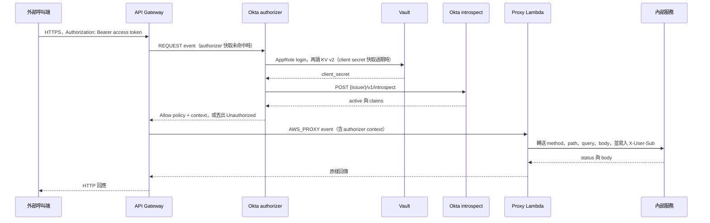

# 對外 API 範例

這個目錄在 repo 根目錄的 `aws-external-api/`，和 `java/`、`csharp/`、`javascript/` 的 state file processor 無關。

它示範一條對外 API 的形狀：

**外部呼叫端 → API Gateway REST API → Okta authorizer Lambda → proxy Lambda → 內部服務**

Okta introspect 用的 client secret 放在 HashiCorp Vault（AppRole + KV v2）。template 裡只有 Parameters，沒有真的憑證。

這是可以照著複製的參考範例，不是已經硬化的正式系統。Java 為 17。兩個 Lambda 都是獨立的 Maven module，上面有一個 aggregator `pom.xml`。

## 架構



`template.yaml` 用 `AWS::Serverless::Api` 建 REST API。預設 authorizer 是 `OktaAuthorizer`（REQUEST）。Identity source 是 header `Authorization`，`ReauthorizeEvery` 為 300 秒。Proxy 掛在 `ANY /{proxy+}`，integration 是 `AWS_PROXY`（SAM 對 Lambda event 的預設）。根路徑 `/` 沒有方法；呼叫時要帶一段 path，例如 `/orders/42`。

Authorizer 預設不進 VPC，因為它要打 Okta 與 Vault。Proxy 的 `VpcConfig` 用 `ProxySubnetIds` / `ProxySecurityGroupIds` 控制：兩個都留空就省略 `VpcConfig`；兩個都有值才把 proxy 放進 VPC。template 裡也留了靜態寫法的註解。

## 為什麼 authorizer 先執行

API Gateway 先叫 authorizer，通過之後才叫 integration。這個路由掛了 `OktaAuthorizer`，所以 proxy 收到請求時，Gateway 已經接受這次驗證。Proxy 不再打 Okta，直接讀 `requestContext.authorizer`。

拒絕時 authorizer 丟出 message 恰好是 `Unauthorized` 的例外。API Gateway 回 **401**，**不會**呼叫 proxy。缺 Bearer、introspect `active` 不是 true、`iss` 不符、有設定 audience 但 `aud` 不符、或沒有 `sub`，都走這條路。

Vault 或 Okta 自己失敗（網路、AppRole 登入失敗、client credentials 被拒）是設定或相依服務的問題，不是這張 access token 無效。這種情況丟一般例外，API Gateway 會把它當成 authorizer 錯誤，呼叫端看到 **500**。這樣才分得出「token 不行」和「authorizer 打不到 Okta / Vault」。

`ReauthorizeEvery: 300` 是 **API Gateway 的 authorizer 結果快取**。同一段 `Authorization` header 在 300 秒內會重用同一份 IAM policy 和 context，authorizer Lambda 不會再被叫到。因此 Okta 端已經撤銷的 token，最久要等這 300 秒才會再被 introspect 看到。

因為這份 policy 會被拿去套在同一個 token 的其他 method 和 path 上，Allow 的 `Resource` 是該 stage 的 `*/*`，不是當下這一個 `methodArn`。若 policy 只允許當下的 `GET /orders/42`，下一個 path 會在快取過期前被同一份 policy 拒絕。

Lambda 記憶體裡另外有一份快取，只放 **Okta client secret**（`VAULT_SECRET_CACHE_SECONDS`，預設 300，`0` 表示不快取）。它不快取 access token，也不快取 Vault token。Secret 過期後會重新 AppRole login，再讀一次 KV。這份快取跟 token 撤銷無關；會延遲撤銷生效的是 API Gateway 那 300 秒。

## 各 Lambda 看到的 path 與 query

呼叫：

```http
GET https://{apiId}.execute-api.{region}.amazonaws.com/prod/orders/42?status=open
Authorization: Bearer eyJ...
```

REQUEST authorizer（`APIGatewayCustomAuthorizerEvent`）看得到 method、path、query、headers，**沒有 body**。Identity 只認 `Authorization` header，query 裡的 token 不會被拿來驗證。

| 欄位 | Authorizer 看到的值 |
| --- | --- |
| `httpMethod` | `GET` |
| `path` | `/orders/42`（不含 stage） |
| `resource` | `/{proxy+}` |
| `queryStringParameters.status` | `open` |
| `headers.Authorization` | `Bearer eyJ...` |
| `requestContext.path` | `/prod/orders/42`（含 stage） |
| `requestContext.stage` | `prod` |
| `methodArn` | `arn:aws:execute-api:{region}:{account}:{apiId}/prod/GET/orders/42` |

Header 名稱大小寫不一定是 `Authorization`。程式用忽略大小寫的方式找這個 header，並接受 `Bearer` / `bearer`。

Proxy（`APIGatewayProxyRequestEvent`）只有在 Allow 之後才會被叫到。它看得到 body，也看得到 authorizer 寫進 context 的 claims。

| 欄位 | Proxy 看到的值 |
| --- | --- |
| `httpMethod` | `GET` |
| `path` | `/orders/42` |
| `pathParameters.proxy` | `orders/42`（沒有開頭的 `/`） |
| `queryStringParameters` / `multiValueQueryStringParameters` | `status=open`。重複的 key 以 multi-value 為準 |
| `requestContext.path` | `/prod/orders/42` |
| `requestContext.authorizer.sub` | authorizer context 裡的字串 |
| `body` / `isBase64Encoded` | 有 body 時才有。Authorizer 看不到這段 |

轉給內部服務的 URL 是 `UPSTREAM_BASE_URL` 接上 `pathParameters.proxy`。Base URL 若是 `https://internal.example.net/api`，上面這支呼叫會變成 `https://internal.example.net/api/orders/42?status=open`。Path 以 `{proxy+}` 的值為準；沒有這個參數時，才從 `path` 去掉開頭的 `/{stage}`。

`events/authorizer-request.json` 和 `events/proxy-request.json` 是同一支呼叫的精簡 event，裡面的 token 是假的。

## Authorizer context

Allow 時回傳 `IamPolicyResponse`：`principalId` 是 `sub`，`policyDocument` 允許 `execute-api:Invoke`，`context` 只放字串。API Gateway 不接受 context 裡的物件、陣列或 null，所以陣列（例如 Okta JWT 的 `scp`）會用空白接成一個字串，物件 claim 直接略過。

有值才會放進去的 key：

| Context key | 來源 |
| --- | --- |
| `sub` | `sub`。沒有就拒絕 |
| `email` | `email`。Introspect 沒回就不放 |
| `uid` | `uid` |
| `username` | `username`，否則 `preferred_username` |
| `scp` | `scp`；沒有 `scp` 時改用空白分隔的 `scope` |
| `scope` | RFC 7662 的 `scope` |
| `cid` | `cid`，否則 `client_id` |
| `aud` | 字串，或陣列用空白接起來 |
| `iss` | `iss` |
| `exp` | 數字轉成十進位字串 |

Proxy 從 `requestContext.authorizer` 讀這些字串，寫進內部請求的 header，並且**蓋掉**呼叫端自己帶的同名 header：

| Context key | 內部請求 header |
| --- | --- |
| `sub` | `X-User-Sub` |
| `email` | `X-User-Email` |
| `scp` | `X-User-Scp` |
| `scope` | `X-User-Scope` |
| `uid` | `X-User-Uid` |
| `username` | `X-User-Name` |

`cid`、`aud`、`iss`、`exp` 留在 context，不轉成 header。`sub` 缺了的話 proxy 回 401，不呼叫內部服務。正式路徑上 API Gateway 不會在 authorizer 失敗後還叫 proxy；這道檢查擋的是有人直接 Invoke proxy Lambda。

Context 在 integration 裡也可以用 `$context.authorizer.sub` 這類變數讀到。這個範例的 integration 是 Lambda proxy，所以是程式讀 `requestContext.authorizer`，不是 VTL。

## Introspect 與 JWKS

這份範例用 **introspect**，不驗本地 JWT 簽章。

Authorizer 對 `{OKTA_ISSUER}/v1/introspect` 發 `POST`，`Content-Type` 是 `application/x-www-form-urlencoded`，body 是 `token` 與 `token_type_hint=access_token`。`Authorization` 是 Basic，使用者名稱是 `OKTA_CLIENT_ID`，密碼是 Vault 讀到的 client secret。`OKTA_ISSUER` 結尾的 `/` 會去掉再接 `/v1/introspect`。例如 issuer 為 `https://your-domain.okta.com/oauth2/default` 時，URL 是 `https://your-domain.okta.com/oauth2/default/v1/introspect`。

`iss` 必須和 `OKTA_ISSUER` 相同（忽略結尾 `/`）。`OKTA_AUDIENCE` 有值時，`aud` 字串要相等，或陣列要包含該值；環境變數空白就略過 audience 檢查。

Introspect 的取捨：每次 authorizer 快取未命中都會問 Okta，撤銷在這次呼叫就能看到；opaque token 也能用。代價是要有 client secret、每次都有網路往返，而且 secret 要放在 Vault。

JWKS 的取捨：Lambda 自己驗 JWT 簽章，不必持有 client secret，延遲比較低，Okta 輪替簽章金鑰時改抓新的 JWKS 即可。代價是撤銷通常要等 token 的 `exp`，而且只適用於 JWT，不適用 opaque token。

API Gateway 的 300 秒結果快取對兩種做法都在。Introspect 只在快取未命中時才看得到撤銷。

## Vault AppRole 與環境變數

Client secret 不在 template、不在 jar、也不在 log。Authorizer 啟動後讀環境變數，需要 secret 時才向 Vault 要。

1. `POST {VAULT_ADDR}/v1/auth/approle/login`，JSON body 為 `role_id` 與 `secret_id`。有 `VAULT_NAMESPACE` 就加 `X-Vault-Namespace`。
2. 從回應的 `auth.client_token` 取得這次用的 Vault token。這個 token 不進記憶體快取。
3. `GET {VAULT_ADDR}/v1/{VAULT_OKTA_SECRET_PATH}`，header 為 `X-Vault-Token`。KV v2 的值在 `data.data.{VAULT_OKTA_SECRET_KEY}`。

`VAULT_OKTA_SECRET_PATH` 是 `/v1/` 後面的 API path，**要含 KV v2 的 `data` 段**。程式不會把邏輯路徑自動改寫成 data path。

範例：secret 在 KV v2 mount `secret`、路徑 `external-api/okta`、欄位 `client_secret` 時，`VAULT_OKTA_SECRET_PATH=secret/data/external-api/okta`，`VAULT_OKTA_SECRET_KEY=client_secret`。

| 環境變數 | 使用它的函式 | 說明 |
| --- | --- | --- |
| `OKTA_ISSUER` | authorizer | Authorization server issuer，例如 `https://your-domain.okta.com/oauth2/default` |
| `OKTA_CLIENT_ID` | authorizer | Introspect 的 Basic auth 使用者名稱 |
| `OKTA_AUDIENCE` | authorizer | 選填。空白就略過 `aud` 檢查 |
| `VAULT_ADDR` | authorizer | 例如 `https://vault.example.com:8200`，不要加 path |
| `VAULT_ROLE_ID` | authorizer | AppRole `role_id` |
| `VAULT_SECRET_ID` | authorizer | AppRole `secret_id` |
| `VAULT_OKTA_SECRET_PATH` | authorizer | KV v2 data path，例如 `secret/data/external-api/okta` |
| `VAULT_OKTA_SECRET_KEY` | authorizer | 預設 `client_secret` |
| `VAULT_NAMESPACE` | authorizer | 選填。Vault Enterprise namespace；OSS 留空 |
| `VAULT_SECRET_CACHE_SECONDS` | authorizer | Client secret 的記憶體 TTL，預設 `300`，`0` 表示每次都讀 Vault |
| `UPSTREAM_BASE_URL` | proxy | 內部服務 base URL，例如 `https://internal.example.net/api`。不可帶 userinfo、query 或 fragment |
| `FORWARD_HEADERS` | proxy | 選填。逗號分隔，用來取代預設的轉送 header 清單 |

Proxy 預設轉送這些請求 header：`Content-Type`、`Accept`、`Accept-Language`、`X-Request-Id`、`X-Correlation-Id`。

就算寫進 `FORWARD_HEADERS` 也不會轉送：`Authorization`、`Cookie`、`Host`、`Content-Length`、`Connection`、`Transfer-Encoding`，以及上面那些 `X-User-*`。`X-User-*` 只從 authorizer context 寫入。

回應只回傳 `Content-Type`、`Cache-Control`、`ETag`、`Last-Modified`、`Location`、`X-Request-Id`、`X-Correlation-Id`。不回傳 `Set-Cookie`。3xx 直接交還呼叫端，proxy 不跟隨重新導向。

`GET` 與 `HEAD` 不把 body 送去內部服務。支援的方法是 `GET`、`POST`、`PUT`、`PATCH`、`DELETE`、`HEAD`、`OPTIONS`。沒有 content type，或 content type 是 `text/*`、`application/json`、`application/xml`、`application/javascript`、`+json`、`+xml` 時，body 當文字回傳。其他 content type 以 Base64 放進 proxy 回應，並設 `isBase64Encoded=true`。呼叫端要收到原始 bytes，還得在 API Gateway 設定對應的 binary media type。內部回應超過 5 MB 時 proxy 回 502。

Authorizer 對 Okta / Vault 的單次 HTTP timeout 是 6 秒，Lambda timeout 是 20 秒。Proxy 對內部服務的 HTTP timeout 是 25 秒，Lambda timeout 是 29 秒。

## 設定 Lambda 環境變數

Template 已經把參數寫進兩個函式的 `Environment.Variables`。部署時給參數即可，不必再進主控台對同一組值設一次。

SAM：

```bash
sam deploy --guided
```

或用參數覆蓋（不要把真的 `secret_id` 留在 shell 歷史或提交進 git）：

```bash
sam deploy \
  --stack-name external-api-sample \
  --resolve-s3 \
  --capabilities CAPABILITY_IAM \
  --parameter-overrides \
    OktaIssuer=https://your-domain.okta.com/oauth2/default \
    OktaClientId=REPLACE_ME \
    OktaAudience=api://external \
    VaultAddr=https://vault.example.com:8200 \
    VaultRoleId=REPLACE_ME \
    VaultSecretId=REPLACE_ME \
    VaultOktaSecretPath=secret/data/external-api/okta \
    UpstreamBaseUrl=https://internal.example.net/api
```

`samconfig.toml.example` 是同一組參數的範本。複製成 `samconfig.toml` 再填。`samconfig.toml` 已在這個目錄的 `.gitignore`。

主控台：Lambda → 該函式 → Configuration → Environment variables。名稱要和上表一致。改完之後，新的 execution environment 會看到新值；已經活著的環境要等它被換掉，或等 client secret 的 TTL 到期才會重讀 Vault。API Gateway 仍可能用舊的 authorizer 結果，直到 `ReauthorizeEvery` 到期。

`VaultRoleId` 與 `VaultSecretId` 在 template 設了 `NoEcho`，CloudFormation 日誌不會印出值。Lambda 環境變數本身對能讀函式設定的人仍然可見。這個範例依需求把 AppRole 放在環境變數；正式環境若要再縮小可見範圍，換掉 `VaultKvSecretCache` 的讀取方式即可，introspect 流程不用改。

## 建置與部署

在這個目錄：

```bash
mvn test
mvn package
sam build
sam deploy --guided
```

`mvn package` 會用 shade plugin 產出：

- `authorizer/target/okta-authorizer.jar`
- `proxy/target/api-proxy.jar`

兩個 module 的 `CodeUri` 分別是 `authorizer/` 與 `proxy/`，`Metadata.BuildMethod` 是 `maven`。`sam build` 會在各自目錄跑 Maven。Compiler release 是 17；建置機器可以是較新的 JDK。Lambda runtime 是 `java17`。

Handler：

- `com.example.externalapi.authorizer.OktaAuthorizerHandler::handleRequest`
- `com.example.externalapi.proxy.ProxyHandler::handleRequest`

Authorizer 的依賴是 `aws-lambda-java-core`、`aws-lambda-java-events`（`APIGatewayCustomAuthorizerEvent`、`IamPolicyResponse`）、`jackson-databind`，HTTP 使用 `java.net.http`。Proxy 使用 `APIGatewayProxyRequestEvent` 與 `APIGatewayProxyResponseEvent`。

部署完成後，stack output `ExternalApiUrl` 是 stage 的 invoke URL。在它後面接路徑，並帶 Okta access token：

```bash
curl -sS "$EXTERNAL_API_URL/orders/42?status=open" \
  -H "Authorization: Bearer $ACCESS_TOKEN"
```

本機測試不需要 AWS。`mvn test` 用 JDK 的 `HttpServer` 充當 Vault、Okta 與內部服務。

## 安全注意事項

- 不要把 access token、Okta client secret、Vault `secret_id`、Vault token 寫進日誌。這個範例的 authorizer 只記 `allow`、`deny: ...` 原因，或錯誤的例外類別名稱。Proxy 只記 method、proxy path 與上游 status，不記 query、body 或 `Authorization`。
- Template 沒有真實憑證。`VaultRoleId` 與 `VaultSecretId` 是 `NoEcho` 參數。不要提交填好的 `samconfig.toml`。
- 兩個 Lambda 的 resource-based policy 都把 `lambda:InvokeFunction` 限制在 `apigateway.amazonaws.com`，而且 `SourceArn` 只涵蓋這一個 API。Authorizer 是 `.../{apiId}/authorizers/*`。Proxy 是 `.../{apiId}/{stage}/*/*`。SAM 轉換時還會再加一份同等範圍的 statement。兩份都不是 `Principal: "*"`。
- Execution role 只給日誌。Authorizer 是 `AWSLambdaBasicExecutionRole`。Proxy 在沒有 VPC 時也是這個角色；有設 subnet 時改為 `AWSLambdaVPCAccessExecutionRole`（日誌加上建立 ENI 的權限）。它們不能呼叫對方，也沒有其他 AWS API 權限。
- 不要把呼叫端的 `Authorization` 轉給內部服務。驗證已經在 authorizer 做完。內部服務若要知道是誰，讀 `X-User-Sub`。Proxy 會覆寫呼叫端傳來的 `X-User-*`。
- 內部服務應放在私網。需要時用 `ProxySubnetIds` 與 `ProxySecurityGroupIds` 把 proxy 放進 VPC。兩個參數要一起設，或一起留空。Authorizer 仍需能走到 Okta 與 Vault；若這兩個端點也只在 VPC 裡，要另外給 authorizer 加 `VpcConfig`，這個 template 沒有幫它加。
- Template 要求 Okta issuer 與 Vault address 使用 `https`。`UPSTREAM_BASE_URL` 允許 `http` 或 `https`，給 VPC 裡的內部服務用。Java 程式本身不強制 https，本機測試才可以指到 `http://127.0.0.1`。
- Authorizer 結果快取會延遲撤銷生效，最長約 `ReauthorizeEvery` 秒。縮短這個值會增加 Okta 與 Vault 的呼叫次數。
- 這個 API 沒有開 CORS。`ANY` 包含 `OPTIONS`，預檢請求也會進 authorizer。

## 目錄

```text
aws-external-api/
  template.yaml
  samconfig.toml.example
  pom.xml
  events/
    authorizer-request.json
    proxy-request.json
  authorizer/
    pom.xml
    src/main/java/com/example/externalapi/authorizer/
  proxy/
    pom.xml
    src/main/java/com/example/externalapi/proxy/
```
